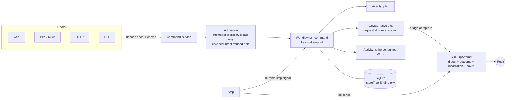

# Converge: one durable command path, owned where the truth lives

## Nouns and invariants

### Status and authority

Owner service ruling, 2026-11-16: "I do not want Sol on fast! thats a waste of my limits. terra is cheap enough that it doesn't matter." All Sol work uses standard service; Terra may use priority. Standing integrator, driver and purger cover the full crusade. Root owns direction and owner rulings. Initial shared-foundation checkpoint `60f08cc2` is partial C1-C6, disconnected from normal host startup and actual doors. It is not S4 acceptance or S6 deletion authority. Main remains at `5209e50c`; no move or push is authorized. Current peer ids, holds and receipts are in root `.artifacts/runs/converge-20261116-wave0/RULES.md` and `STATE.md`.

The owner accepted this plan and explicitly authorized S0. This does not resume the old crusade or authorize this implementor beyond S0. A blocking gate remains before S4: the responsibility-transfer table (`muse-d0/responsibility-transfer.md`) must assign every journal responsibility, its consumers and a failure-boundary falsifier, with no unowned row. OD8 supplies the conservative policy for E6-E8, not implementation proof. The non-author review findings below remain in force. Cutover starts from the main tip at its start, not the held `6ebcd784`; harvest old branches only through a census-named slice.

Evidence home: root checkout `.artifacts/runs/converge-20261115/muse-d0/`. Run state: `muse-d0/STATE.md`. The earlier discovery map is in Git at `0fa80cde`.

### Root cause

Only Revit knows whether an edit landed, but the host rebuilt that fact for each feature. So every consumer inherited infrastructure work it should not own:

- a 25-member executor contract (`ts/apps/host/src/command-executor.ts`);
- a per-feature `recover` that guesses from receipts (`family-actions.ts:944`, `gateway-actions.ts:448`, `command-registry.ts:83`);
- a hand-built durable engine (`action-journal.ts`, 2,345 lines);
- two names for one session, translated per door (bugs B2, B3, B6 in `rooms-draw-baseline/REPORT.md`);
- Work retirement that each feature must opt into (bug B4).

The native side had the primitive (SDK `MutationAdmission`) but the Pe.Tools bridge treated it as best-effort diagnostics, so real Revit ran a resent id twice (`sdk-dedupe/REPORT.md` phase A).

The general rule: effect identity belongs to the owner of the effect. A native edit gets it from `OpAttempt`. A host file effect (archive install, scratch-page retirement, export; `gateway-actions.ts:379`) gets it from a create-only or content-addressed write at its own owner, because Revit cannot dedupe it and a durable Activity can re-run. Host-internal state changes inside the workflow's own SQLite transaction. The journal also owns host authority that no native owner replaces: authorize and preflight gates, ordered admission, claim release gated on dispatch evidence, parent-run Stop, descendant-read settlement and completion-persist failure (`action-journal.ts:1558`, `:1790`, `:1833-1928`). Those transfer to named host owners through the responsibility-transfer table.

### Nouns

| Noun | Meaning | Owner |
|---|---|---|
| Attempt | One request id with one intent digest: op key, stable document identity, canonical payload text. | SDK `OpAttempt`, below every door into Revit |
| Outcome | What Revit recorded for an attempt, bound to the process incarnation, the document open instance and saved-after-commit. Cases: completed, refused, conflict, answered elsewhere, admission unavailable, in flight, committed in an ended incarnation (saved or unsaved), and unknown (started, no terminal, incarnation ended). Native identity prevents a second run; it does not make the edit and its record atomic, so unknown stays an honest outcome. | SDK `OpAttempt` |
| Admission | The create-only binding of an attempt id to its intent digest, caller and target, written before any execution. An identical resubmission joins; a changed one is refused here, before the Workflow runs. | Host admission service, one SQLite row per attempt id |
| Command | One durable host execution of an admitted attempt. Key: the attempt id only, so a resubmission can never fork a second execution. One Activity per step; each native step's request id derives from the execution. | Effect `workflow` on `ClusterWorkflowEngine` + `SingleRunner` + SQLite |
| Host effect | A file or store write the host itself performs inside a command (archive install, page retirement, export). Its identity is a create-only or content-addressed write keyed by the step's request id, so a re-run Activity finds the effect already done. | The owning host store |
| Work | Editable intent with revisions. Consumed cells retire by core default when the outcome is completed, and return to staged when the outcome becomes committed-in-ended-incarnation-unsaved. A newer edit is never retired. | Host Work owner |
| Session | One name: the SDK session id plus its exact process incarnation. The bridge id is private to the bridge. | SDK session row |
| Reading | One shared native read per key; the last observer retires it. | Effect `RcMap` over the serial native slot |
| Contract | C# DTOs and op metadata are the authority; Effect Schema is generated from them. | C# + generator |
| Door | HTTP, Pea/MCP, web, CLI. A door decodes, calls one service method, and maps the typed failure once. | Each door, thin |
| Feature adapter | Intent schema, optional plan step, native steps, result interpretation, optional consumed-cell override. Nothing else. | Each feature |

Legacy names that do not survive: `CommandExecutor`, `CommandBinding`, `StepRecovery`, `bridgeReply`, `opReceipt` (host copy), `action.recover`, `action.resume`, the bridge id as a door-visible session name. The facts behind `dispatchedAt` and step state `unknown` survive on their new owners (claim release needs dispatch evidence; unknown is an honest outcome), per `muse-d0/responsibility-transfer.md` rows A2, C1-C3 and W3-W5. No domain behavior is deleted because `OpAttempt` or the Workflow exists.

### Target shape

### Invariants and their current proof

| # | Rule | Proof now |
|---|---|---|
| I1 | At most one native commit per attempt id, across both doors and across a session restart. | PROVEN[session, acc-dedupe-b, Pe.Tools 965e2ae9 + SDK beta.222, 2026-11-16T08:17Z] for the bridge across restart and for both doors in one incarnation (`sdk-dedupe/REPORT.md` phase E). At-most-once held on every observed leg. The phase E replay-classification fault (digest bound `openId`) is fixed: PROVEN[session, acc-dedupe-d, Pe.Tools 12bd0cfd + SDK beta.224, 2026-11-16T09:24-09:48Z] the digest uses the SDK document key and both doors answer a post-restart resend with the typed ended outcome (`sdk-dedupe/REPORT.md` phase F). |
| I2 | A changed intent under the same id is refused, never joined and never forked. | PROVEN natively (409 `AttemptConflict`, phases C and E). The Workflow joins silently on its key (`engine-probe/REPORT.md` case 5), and a digest in the key would fork a second execution whose derived step ids escape the SDK check. So host admission binds attempt id to digest create-only and refuses before execution. Owed S4. |
| I3 | The host never reports applied for an edit that is no longer in the document without saying so. | Native half PROVEN[session, acc-dedupe-d, Pe.Tools 12bd0cfd + SDK beta.224, 2026-11-16T09:24Z]: a resend after restart without save answers `AttemptEnded` / `op.attempt-ended` with `savedAfterCommit:false` and the readback shows the edit gone; after a save it answers `savedAfterCommit:true` and the readback shows the edit. The phase E fault (plain ok, H20) is retired. Limit: proven only for a controlled stop. Revit's fatal-error dialog can write recovery copies, so after a crash `false` means only that no save of the original file was witnessed; the SDK owes a recorded reason for the process end. Host half owed S4. |
| I4 | A retired request is in the model or saved. | PROVEN[deterministic TLC, `muse-d0/retire-model/`, no code, 2026-11-16] only for an abstraction where every save is observed, never fails and is never undone: there, retire-on-commit breaks in 5 steps and both alternatives hold. The model has no missed save event, failed save, Save As destination, sync-with-central, undo or later deletion, so it does not prove OD1 safe. UNPROVEN[real save observation]. Owed S1 (what the SDK can honestly report) and S4. |
| I5 | A newer Work edit survives retirement of consumed intent. | Source testimony: conditional retirement at `action-journal.ts:1558`, with `work-write-boundary.ts`. Not modeled (`retire-model` has no such rule). Carried to S4 as a drive case. |
| I10 | A host file effect runs at most once per step request id, across an Activity re-run. | UNPROVEN. Today `gateway-actions.ts:379` installs an archive and retires a scratch page with no step identity at the store. Owed S4. |
| I6 | Stop never relies on `Workflow.interrupt`. | `Workflow.interrupt` sticks only at suspension points (`engine-probe-interrupt/REPORT.md`, 4.0.2 and 4.0.3). Stop is a durable stop signal plus native `op.cancel`. Owed S4. |
| I7 | One writer per engine database. | UNPROVEN, owed S4 (`ship-sqlite/REPORT.md`: a `--no-revit` dev host can share a checkout root). |
| I8 | Doors hold no infrastructure classification and no session-name translation. | FALSIFIED today by B2, B3, B6. Owed S2, S8. |
| I9 | One contract source; recordings and runtime decode against the generated schema. | FALSIFIED today: the recorded space-scene response no longer decodes against the current catalog schema (`schema-perf/REPORT.md`). Owed S3. |

### Evidence register

| Claim | Stamp | Where |
|---|---|---|
| Revit runs a resent id twice and again on a changed payload | PROVEN[session, acc-dedupe-a pid 24744, 5209e50c, 2026-11-16T07:11Z] | `sdk-dedupe/REPORT.md` phase A, `ev/A4`, `ev/A6` |
| Both doors into Revit reach the same op code (`SdkOperations.cs:50`), so a Pe.Tools-only fix leaves `/op/run` open; `OpAttempt` mechanism works | PROVEN[deterministic, SDK 368f4ac tests failing once with the fix removed, 2026-11-16] for the mechanism; the "deepest owner" choice is a design argument, not a test result | `sdk-dedupe/REPORT.md` "Homes considered" |
| SDK beta.220-224 released from master (latest 9e202bb), adopted on `t3/native-mutation-dedupe-spike` 12bd0cfd | PROVEN[artifact, local feed listing + spike `global.json`, 12bd0cfd, 2026-11-16] | spike branch |
| `families.apply` through the web Families page: one apply lands (`E070-FF1` by readback); identical native resend runs no second Family Foundry pass; changed resend gets 409 `AttemptConflict`; resend after restart without save gets `AttemptEnded` saved false and the family reads back original | PROVEN[browser + session, acc-dedupe-d Revit 63620 and 62984, 12bd0cfd, 2026-11-16T09:45-09:48Z] | `sdk-dedupe/REPORT.md` phase F, rows Z0-Z7 |
| Family Foundry cannot take a type-cell edit on a single-type family whose family-document type is named `" "` (it shows under the family name in the project) | FALSIFIED[browser + session, acc-dedupe-d Revit 63620, 12bd0cfd, 2026-11-16] | `sdk-dedupe/REPORT.md` phase F; Family Foundry ledger Owed, outside this effort |
| Effect workflow on SQLite: resume on boot, identical resend joins, typed failure survives restart, durable deferred survives restart | PROVEN[deterministic, `engine-probe/replay.out`, effect 4.0.2 standalone, 2026-11-16]; persistence mechanics only, not desktop lifecycle fitness | `engine-probe/REPORT.md` |
| Three engine catches: in-flight Activity re-runs; changed payload silently joins; interrupt sticks only at suspension points | PROVEN[deterministic, `engine-probe/`, `engine-probe-interrupt/v402,v403`, effect 4.0.2 and 4.0.3, 2026-11-16] | `engine-probe/`, `engine-probe-interrupt/` |
| Graceful shutdown with a long run takes 15-23 s and logs "No healthy runners available" | observed[deterministic, engine-probe run log, effect 4.0.2, 2026-11-16]; no bounded-shutdown falsifier yet | `engine-probe/REPORT.md` |
| The packed `Pe.Host.exe` keeps `node:sqlite` external and runs a workflow on SQLite with Node v25.7.0 | PROVEN[artifact + packed-exe run, t3/sea-sqlite-cluster-probe 4f214622, 2026-11-16]; UNPROVEN[installer SEA builder path] | `ship-sqlite/REPORT.md` |
| `RcMap` covers shared read, cancel on last leave, idempotent release, shared error; it lacks refuse-while-retiring and owner settle | PROVEN[deterministic, effect 4.0.2] | `rcmap-probe/REPORT.md` |
| Effect Schema is 1.4-6x slower than zod; about 40 ms on a 10 MB response, microseconds on ordinary bodies | PROVEN[deterministic gauge] | `schema-perf/REPORT.md` |
| `rooms.draw`: no web draw control; Pea draw fails on main through B1-B3; native resend and re-plan duplicate regions | PROVEN[session, acc-rdb, a31ed6e9, 2026-11-16T08:53-08:59Z]; web verdict from source only | `rooms-draw-baseline/REPORT.md` |
| Journal-state reader census: 20 delete-candidate, 8 keep, 10 unsure | testimony[source read, partial; `action-journal.ts:1795-1960` unread]; superseded by the next row | root summary in this map, S6 |
| Responsibility-transfer table: 79 rows; owners Workflow/Activity 23, admission 17, door/mapper 11, read owner 9, Work 6, host effect 6, OpAttempt 2, delete 2, unowned 3 (E6 outward delivery, E7 external process launch, E8 external auth transition) | testimony[source read of `action-journal.ts` in full and collaborators, main 5209e50c, Sol, 2026-11-16]; UNPROVEN[falsifiers not run] | `muse-d0/responsibility-transfer.md` |
| A lost reply in the old journal model leads to a duplicate on resend without native dedupe | PROVEN[deterministic TLC, model only] | `muse-d0/attempt-model/` |

### Open decisions with reopenable defaults

| # | Decision | Default in this map | Why |
|---|---|---|---|
| OD1 | When consumed Work retires | Retire on completed outcome; re-stage when the SDK reports committed-in-ended-incarnation with `savedAfterCommit:false` after a controlled end; after a crash, offer the re-stage to the person instead of doing it, because a fatal-error recovery copy may hold the edit; keep the retired intent recoverable from command history in every case | Immediate feedback. The model only shows the policy is consistent under perfect save knowledge; Save As, sync-with-central, a failed save, undo and later deletion are not observed, so a re-stage is a best effort and history is the backstop. ADR 0038 held save/sync/discard acts stay with the person. |
| OD2 | Stop semantics | Stop cancels the in-flight native step at its next checkpoint (`op.cancel`) and prevents every later step through a durable stop signal. Stop is allowed from a history view for an already admitted live attempt, using that attempt's own authority. History never authorizes a new write or a retry. | Matches the earlier recommendation in `CRITICAL-ARCHITECTURE.md`; the Workflow interrupt gap forces our own signal. |
| OD3 | Large native ids on the wire | Refuse unsafe integers at decode; carry element ids that can exceed 2^53 as strings | E0 showed every arm accepts unsafe ids; a string id is honest. |
| OD4 | Reads beside a retiring read | Queue through the serial native slot; delete refuse-while-retiring | Deletes two hand-rolled refusals (`read-ownership.ts`, `native-reads.ts` `ReadRetiring`). UNPROVEN until S7 probes it. |
| OD5 | Old journal file | Follow ADR 0039's incompatible-journal policy (discard with notice, prior bytes set aside); no migration; old unsettled attempts never authorize new writes | Keeps one failure policy by class instead of a special case. |
| OD6 | Held Converge branches and the 12 paused roles | Superseded; harvest only census-named changes into a slice | No sunk cost (owner, 2026-11-15). |
| OD7 | Same-Pod shared values; web draw control for rooms (B8) | Out of this effort; one Owed line each in the pods and rooms ledgers | Product questions, not command-path causes. |
| OD8 | Effects whose outcome only an outside party knows: outward delivery (E6), external process launch (E7), external auth transition (E8) | At most once per admitted attempt: the Activity writes a create-only "started" mark in the engine database before it acts; a re-run after a crash answers unknown and never acts again; the person decides, as ADR 0038 already holds outward sends | No owner can dedupe them. This marker is a named hand-rolled remainder, because Effect `workflow` has no at-most-once Activity; the site comment says so. |
| OD9 | Engine database discarded under ADR 0039 | Keep a discard epoch outside the database; refuse any resend whose admission predates the epoch | A discarded identity store would otherwise let an old sender recreate an attempt that already had an effect (`responsibility-transfer.md` principle limit 9). |

### Unresolved foundation gates

The sealed root `.artifacts/runs/converge-20261116-wave0/foundation-smeller.md` and adjacent `BACKLOG.md` name these holds. They refine acceptance, not the accepted OD1/OD8/OD9 defaults or the selected owners. Source findings are inherited testimony here; no behavioral falsifier below has run in S0. Owner allocation alone does not certify sufficiency.

| Gate | Held claim and required falsifier |
|---|---|
| FND-01 | UNPROVEN[save witness continuity]. Hold S1 definitive unsaved classification and S4 automatic re-stage even after controlled close. For an already admitted completed edit, suppress both save-event writes despite successful save; the SDK must return unknown rather than false unless it proves continuous observation. Separately corroborate the event path in a disposable Revit session. OD1 remains ruled, not silently replaced. |
| FND-02 | UNPROVEN[upgrade replay safety]. Freeze original Workflow tag/execution id, recipe/code compatibility identity and derived step request identities at admission. The logical attempt-id key does not freeze Effect's tag-dependent hash or Activity meaning. After A completes and B suspends, upgrade A's input/meaning or insert a step; boot must use a compatible frozen continuation or refuse before a new effect. A resend through a renamed tag must find the original execution, never fork native keys. Preserve D2 until this passes. |
| FND-03 | UNPROVEN[original-admission classification after discard/retention]. OD9's external epoch must classify the original admission using trustworthy original provenance or retained safety identity. Sender timestamps, a resend flag and a naked UUID are insufficient; retries cannot refresh provenance. After OD8 started/acted/result-lost, discard DB and advance epoch; restart twice and resend with absent metadata and advanced sender clock. Require zero second effects for old/unprovably new requests, while an explicitly new authored attempt works. Repeat across retention and between discard steps. OD8/OD9 remain ruled. |

Root foundation holds override compile cleanup. These gates must pass on their owning slices before the affected safety claim or deletion lands.

## Ordered deletable slices

### Strategy

1. **Root first, on two consumers (the crusade implementor's wave 0).** S1-S4 land the native truth, the session name, the contract source and the durable core, and prove them on `families.apply` and `rooms.draw`. No consumer sweep starts before both pass their drive cases. Two consumers keep the core from fitting only Family Foundry.
2. **Then force every consumer onto it.** S5 converts each command family whole: its producers, its route through the one failure mapper, and the deletion of its old executor members in the same change. A resolved-import guard refuses any new import of the legacy executor or journal from a converted family.
3. **Purge trails each wave.** The purger works behind the implementor on the same family and deletes what the conversion made dead. It reports responsibilities removed, not lines.
4. **Foundations have priority.** The smeller has unlimited foundation investigation resources and authority to redirect the root design. Root foundation holds override compile cleanup. See Roles and the latest owner verdict in the decision log.

### Slices

| Slice | Work and deliverable | Falsifier and observed paths | Deletes |
|---|---|---|---|
| S0 Authority | ADR 0046: effect identity belongs to the effect owner; native attempt identity and outcome live in the SDK `OpAttempt`. ADR 0047: durable commands run on Effect `workflow` over SQLite with create-only admission before execution; supersedes ADR 0029 rule 9 for `workflow`, `cluster` and `sql`, and restates rules 14 (causal descendants) and 15 (bounded retention) on the new owner. ADR 0048: C# contracts generate Effect Schema; zod leaves the operation surface. Amend ADR 0031 (journal and receipt producers stay swappable recorded inputs on the new owner), ADR 0033 (ActionJournal responsibilities move to named owners), ADR 0039 (journal class policy names the engine database). Edit `docs/ARCHITECTURE.md:34` and `:109`. Correct `docs/features/host/EFFECT-V4-PATTERNS.md` per `critical-effect-semantics.json`. | Fails if any of ADRs 0029, 0031, 0033, 0038, 0039 is contradicted without an amending ADR, or ARCHITECTURE.md still names ActionJournal recovery or zod as the operation model. Observe those ADRs, ARCHITECTURE.md, EFFECT-V4-PATTERNS.md. | ADR 0029 rule 9's rejection of `workflow`/`cluster` |
| S1 Native truth | Mostly proven on the spike (SDK beta.224, Pe.Tools `t3/native-mutation-dedupe-spike` 12bd0cfd): stable document key in the digest, outcome bound to incarnation, open instance and saved-after-commit, one wire code per refusal. Remaining: record why a process ended (controlled stop, crash, fatal-error recovery save) so `savedAfterCommit:false` is honest after a crash; supervisor ops (document open, dialogs) through `OpAttempt` or a named exemption. Pe.Tools: harvest the spike branch onto the cutover base. | Revit drive on a disposable copy: identical resend replays; changed resend conflicts; both doors share one attempt; restart without save answers "committed in ended incarnation, unsaved"; save then restart answers "saved" and the readback shows the edit; fail-closed admission runs nothing. Observe `Pe.Revit.Loader/OpAttempt.cs`, `MutationAdmission.cs`, `OpReceipt.cs`, `BridgeAgent.cs`, `BridgeRequestPump.cs`, `SdkOperations.cs`. | `BridgeAgent.BeginOpReceipt` best-effort path; Pe.Tools-side duplicate handling in `BridgeRequestPump.cs:67` |
| S2 One session name | Doors receive only the SDK session id with its incarnation; the bridge resolves its private id. Delete per-door translation, including the branch fixes `bridgeSessionFor` (`rooms-draw-baseline` B2, B3) and the B6 target conflict. | Pea stages, previews and applies a draw by SDK session id on main; a retry under the original action id recovers its result; a stale incarnation refuses. Observe `ts/packages/mcps/src/pea/capability-tools.ts`, `route-state.ts`, `bridge.ts`, `host-ownership.ts`. | Every door-side session-id mapping |
| S3 Contract source | Generator from C# JSON Schema to Effect Schema, fixing date-time validation, defaults, int32 limits and OD3. Generated schemas become the native operation contract. Move the Pod read door to Effect Schema. Re-record or re-decode every recorded fixture against the generated schema. Unconverted consumers keep zod behind one named temporary boundary (`fromStandardSchema`), which only shrinks; each S5 family deletes its own zod when it converts, and S6 deletes the boundary. Runs in parallel with S4. | E0 refusal corpus passes on the generated arm; the one-way encode guard refuses at compile time (`encoding-spike/directionality.json` positive case); every recording decodes; the zod import count never grows. Observe the generator, `@pe/host-contracts`, `@pe/agent-contracts`, Pod door, recordings. | zod in generated native contracts; the rest per family in S5 and S6 |
| S4 Durable core | Gate: the responsibility-transfer table (`muse-d0/responsibility-transfer.md`, 79 rows) has no unowned row once OD8 is ruled, and its blocking rows (A2, A7, Z1-Z5, S2-S3, S7, C1-C3, W3-W5, R3, R6-R8) each name a falsifier. Composite effects (install then retire) get one recovery checkpoint per effect. Receipt and History publication are rebuilt from durable authority after a crash, not from a subscriber. Then: create-only admission (attempt id to digest, caller, target) before execution; `CommandWorkflow` service with one Workflow per attempt id; Activities per plan, native step, host effect and retirement; host effects keyed by step request id at their store; every responsibility row assigned to the host owners it names (authorize and preflight gates, ordered admission, claims, parent-run Stop, descendant-read settlement, completion-persist failure); SQLite through a `stateTree` "Engine" row with a single-writer lock; SEA Node version pinned or recorded in the build receipt; Stop per OD2; Work retirement per OD1 as core default. Feature adapter contract as in Nouns. Convert `families.apply` and `rooms.draw`. | Native drives for both consumers: one apply; lost reply; host killed mid-step and restarted; host shut down during a native commit, within a stated shutdown bound; Revit restart without save; newer edit survives; Stop mid-step and from history; re-plan over consumed Work is refused or no-op; changed intent under the same id is refused at admission. Engine gates: a corrupted engine database fails closed with notice (ADR 0039); command history stays within a stated bound (ADR 0029 rule 15); a handler upgraded between crash and resume replays safely or refuses. Every responsibility-table falsifier passes. Kill S4 if a consumer must classify infrastructure failures, reconstruct native outcomes, keep a feature-specific core branch, or dedupe its own effects. Observe the new service, both adapters, `work-write-boundary.ts`, SQLite rows, Revit readbacks. | `family-actions.ts` `recover`, `family-run-recovery.ts`, `rooms.draw` executor members |
| S5 Consumer sweep | Convert each family whole, in this order: takeoff (rest), ducts, gateway (first host-effect consumer), schedule, instances, sheet, catalog work, findings, bootstrap and page publication. Then the journal's non-command readers: the Timeline input (`reads/inputs.ts:105`), scheduled mining's action-receipt join (`scheduled-tasks.ts:165`), Pea thread ownership, MCP causal Stop, and recording/replay of journal and receipt inputs (ADR 0031). One implementor per wave; purger trailing; smeller beside. | Per family: its existing user surface driven once with a real write and an independent readback; for gateway, a host kill mid archive install leaves one install; the resolved-import guard green; its old executor members and zod deleted. Per reader: its own acceptance path named in the responsibility table, driven once. Observe each `*-actions.ts`, `slots/*.ts`, `command-registry.ts`, and each reader's site. | Each family's `CommandExecutor` members, `recover` and zod |
| S6 Delete the old engine | Delete `action-journal.ts` (its JSONL format, torn-tail folding, write tail and mirrored indexes: table rows P2, P7), `command-executor.ts` legacy interface, `native-receipts.ts` recovery, `receipt-services.ts` parts that only served it, `action-dispatch.ts` `markDispatched`, `action.recover`/`action.resume` (`call-route.ts:747,758`, `apps/web/src/ops/route.ts`), and the zod boundary from S3. Web `unknown-until-reconciled` (`work-feed-client.ts:310`) becomes a projection of the honest unknown outcome, not a deletion. | Fails if any table row loses its owner, a surviving reader needs a deleted record, or a web view loses "failed before Revit" wording without a native fact behind it. Observe a fresh resolved-import census and every consumer named in the table. | About 3,000 host lines; exact count taken at the slice's census |
| S7 Reads | Shared native reads on `RcMap`, routed through the serial native slot; owner Stop as a child Scope; settle with `FiberSet`. Decide OD4 by a probe. | Two observers share one native read; the last leave cancels it once; a new read during retirement queues and never runs beside the old one in Revit; owner Stop detaches every lease. Observe `reads/read-ownership.ts`, `native-reads.ts`, `publications.ts`. | `startFlight`, one or both `ReadRetiring` refusals |
| S8 Thin doors | One failure mapper per wire; remove the Page self-HTTP hop (`pages-route.ts`, `CRITICAL-ARCHITECTURE.md` finding 1); request lifetime owns reads, the Workflow owns commands. | A disappearing Page reader cancels its read; a navigation away leaves an admitted command running; no door classifies by message text. Observe `pages-route.ts`, `call-route.ts`, `http-problems.ts`. | Per-route catch and problem projection |
| S9 Sweep | Promote decisions to the host, pods, rooms and routes ledgers; delete this map; dispose of held branches per OD6. | Fails if a decision exists only here. | This map |

### Roles

| Role | Charter | Stops when |
|---|---|---|
| Implementor | One per wave. Owns one slice or one family. Lands it on its branch with its falsifier green and its deletions done. | Slice falsifier green and deletions landed |
| Purger | Trails the implementor on the same paths. Deletes what the conversion made dead; reports responsibilities removed and remaining callers. | Two waves in a row with nothing left to delete |
| Smeller | Investigates foundation ownership and direct or transitive coupling without a wave-path or resource cap. Files ranked findings to the run `BACKLOG.md` and can redirect foundation work. Repeated defects become guard requests. Does not silently grant runtime proof or resume paused work. | Owner rules on conclusion or blocker; two dry rounds are a checkpoint, not an automatic retirement or foundation budget cap |
| Reviewer | Non-author review of S1, S4 and S6 before their landing, because they carry admission, dispatch and durable state. | Review stamped |
| Driver | Runs each slice's native or browser drive on its own controlled session and disposable copy. | Drive stamped |

Staffing: Sol or Terra can run every role from these briefs. Each brief carries its slice row, its exact file set from a fresh census, and its falsifier.

## Deletion criteria

### Consumer cases (fixed before S4 implementation)

1. **Write and retry:** the same authored edits, sealed bytes and exact document identity reach Revit once; an identical resend replays; a changed resend under the same id is refused.
2. **Lost reply and host restart:** a real native commit, a lost response, a host kill and restart; the Workflow resumes and the SDK answers from its record; no second commit by readback.
3. **Revit restart:** an unsaved commit lost with its process re-stages its Work (OD1); a saved commit stays retired and reads back present.
4. **Newer edits:** a staged cell changed before recovery survives retirement of consumed unchanged intent.
5. **Authority and bytes:** history and a copied admission cannot authorize a new write; a conflicting authored-file write preserves prior bytes.
6. **Generality:** `families.apply` and `rooms.draw` pass cases 1-5 through the same core with no feature branch in the core. `rooms.draw` proves a multi-step command and an element-creating op; `ducts.apply-heal` covers Work cell retirement if `rooms.draw` cannot.
7. **Reads:** two observers share one native read; losing one keeps it; losing the last retires the native join; a recorded read cannot fetch a live value.

### What a feature author supplies, before and after

| Before (`command-executor.ts`) | After |
|---|---|
| `definition`, `prepared`, `sealInput`, `seal`, `bind` (returns `consumes`, `claims`, `effects`, `basis`, `preflight`, `prepare`), `run`, `recover`, `boundary`, `retires`, `cancel`; context with `admission`, `caller`, `basis`, `work`, `consumed`, `selectWork`, `read`, `clock`, `ids` | intent schema, optional plan step, native steps, result interpretation, optional consumed-cell override |

### Kill criteria per shape

- Kill the Workflow core if a consumer must handle a duplicate activity itself, if Stop needs per-consumer code, if the engine database needs a second writer, or if shutdown during a native commit cannot meet a stated bound.
- Kill the plan if any responsibility-transfer row stays unowned after S4's gate review.
- Kill `OpAttempt` as the identity owner if any door into Revit can dispatch a mutation without it.
- Kill the Schema generator if a recorded native payload cannot decode without a hand-written exception.
- Kill retire-on-commit-with-re-stage (OD1) if the SDK cannot report saved-after-commit; fall back to retire-on-save.

### Measures

Judge by responsibilities removed from callers, independent state owners deleted, and dependency direction. Line counts are gauges. The expected deletions are `action-journal.ts` (2,345 lines at 5209e50c), the per-feature `recover` functions, `native-receipts.ts` recovery, two read-refusal implementations and the zod operation kernel.

## Risk tier per surface

| Surface | Risk and proof before landing |
|---|---|
| SDK `OpAttempt`, bridge dispatch, outcome binding | High. Non-author review; controlled Revit drives on disposable copies for every case in S1. |
| Workflow engine, SQLite state, Work retirement | High. Real filesystem kill and restart; SQLite rows read back; single-writer refusal shown. |
| Session identity and doors | High where a wrong session can arm a write. Pea and browser drives through real controls. |
| Contracts and generator | Contract risk. Compiler and corpus evidence; recordings decode. |
| Reads | Medium. Deterministic `TestClock` probes plus one native two-observer drive. |
| Probe and spike scaffolding | Bounded. Never merged; measured as cost. |

## Decision log

- Prior rulings and execution decisions are retained in Git at `6ebcd784` and in the owning ledgers. This replacement changes the route, not the established safety requirements.
- Owner: "i dont actually care if the apis remain stable, but if they change they must improve in UX." Public Pod signatures are not frozen.
- Owner: "pause or rescope the implementor if their work will b superseded" and "numbers are just a proxy for good". The implementation wave remains held; metric-only cleanup is not authority to continue it.
- Owner: "we should more openminded muse and consider starting over from sratch". Repair has no sunk-cost preference; replacement scope is an open decision.
- Owner: "our coupling also needs fixing, so thats 100% in scope". Isolation prerequisites count toward the real change. The existing strict-isolation claim was falsified; a wholesale rewrite requirement remains unproved.
- Owner: "some existing guards, skill scripts, or prototyped sensors may give some leads". Reuse and audit those instruments before inventing another analyzer.
- Owner: "ok are we ready to write the map? i wanna start this with a new agent". This map and cold handoff supersede the old implementation sequence. They authorize bounded discovery under the limits above, not a selected architecture or resumed crusade.
- Open: same-Pod named shared values and raw Page-state access; Stop of an already-admitted attempt while viewing history; schema/wire direction; durable history versus active projection. No silent policy defaults beyond the prior settled behavior.
- Settled: no new write authority from history; no legacy shims/migrations; preserve bytes per class; copied-model SDK custody; Sol/Terra only; branch-only delivery; no main/GDrive/user-runtime changes. A later implementation map requires an owner verdict on its direction and plan.
- Owner, 2026-11-15: "again im aiming for root problem fixes. no matter how huge the lift is". Scope follows demonstrated responsibility/coupling causes across C# domain libraries, shells, TypeScript feature adapters and shared execution owners. FF is the proving consumer, not a scope ceiling. Discovery bounds remain checkpoints; they do not constrain the size of a justified replacement. Architecture/UX verdict and cutover gates remain in force.
- Owner, 2026-11-16: "sdk is at ~/source/repos/pe.revit.sdk. changes are allowed an encouraged." The pe-revit SDK is in Converge scope. A root fix may move attempt admission, id dedupe or receipt authority into the SDK and the Pe.Tools native bridge.
- Owner, 2026-11-16: "workflow makes a ton of sense to me for replacing it [the journal]". Effect `workflow` replacing ActionJournal is the leading candidate. It reopens ADR 0029 rule 9, which rejected `workflow` and `cluster` only as a second owner beside the journal. Adoption still waits on the engine probe and the SDK dedupe spike.
- Owner, 2026-11-16: "i dont want to handroll anything at all that we can avoid, which goes for our leases among many others too". A library primitive at the pin beats a hand-rolled owner. Hand-rolled read leases, locks, logs and refcounts are deletion candidates, and each survivor names the primitive that refused it.
- Owner, 2026-11-16: "i have always thought schema was a better option ... i do not at all carea bout changing the pod door". Effect Schema is the contract direction. The Pod read door may change freely. The earlier E0 hold rested on encoding-performance worry, so performance is measured, not assumed.
- Owner, 2026-11-16: "i wo8uld love sqlite, id actually been thinking of moving a few of our stores to it once contracts settled." SQLite through Effect `sql` is welcome as the durable store, starting with the workflow engine.
- Owner, 2026-11-16: "i do not care about minors/unstable/experimental. we should always use whats there because theires will always be better". `@stability unstable` and `experimental` modules at the exact pin are acceptable. Upstream primitives beat hand-rolled ones; the exact pin and its bump-as-own-change rule still hold.
- Owner, 2026-11-16, on a native step re-running after a host crash: agreed to "let the SDK spike's cost decide", adding "searche xtra hard for the proper deep home even if it doesnt seem like the fix is small at first". Host-side machinery for the re-run is rejected. The dedupe belongs at its deepest native owner even when that fix is not small; only a demonstrated boundary there makes it an accepted, recorded edge.
- Owner, 2026-11-16: "yes to all. release thru master with dotnet tool run pe-revit sdk adopt, u can do some back and forth releases if need be. full gates take forever, they are not required." Merge SDK `t3/native-attempt-identity` to SDK master, cut beta.220 (and later betas as needed), adopt it on the spike branch with `dotnet tool run pe-revit sdk adopt`, and prove `OpAttempt` and `families.apply` in Revit. Full SDK gates are not required for these releases; the owner runs them weekly. Targeted checks and the native drive still carry the proof.
- Owner, 2026-11-16, on `rooms.draw` as the second mutation consumer: "fine with me, but i dont remember ever having seen this work personally. so u must drive it in revit and expect to see some unnoticed bugs". `rooms.draw` is the D1 second consumer. It gets a baseline native drive through its real user surface before any candidate is compared on it; its behavior is UNPROVEN until then.
- Owner, 2026-11-16: "the strategy should be root cuase fix first then force ever consumer to abide with agressive purge trailing and maybe a new \"smeller\" role alongside to continue finding anything that even remotely smells." Root slices S1-S4 land on two consumers before the sweep; S5 converts every family whole with purge trailing; the smeller is scoped to the wave's paths and retires after two dry rounds (root pushback accepted in conversation before the owner slept; not yet confirmed).
- Root, 2026-11-16: the map was rewritten as the convergence proposal from the muse-d0 evidence. The owner did not answer whether to commit it, so it stays uncommitted on `t3/converge-implementation-plan-check`.
- Review, 2026-11-16 (Sol, non-author, read-only, main 5209e50c): FALSIFIED the first draft's "discovery complete". Accepted findings: a digest in the Workflow key forks executions, so admission binds id to digest before execution; the retire model assumes perfect save knowledge; host file effects need their own identity; the journal tail holds host authority with no named owner; zod deletion moved per family; ADRs 0031, 0033, 0039 and ADR 0029 rules 14-15 need amendments; engine lifecycle gates added; stamps narrowed. Its most important change, a blocking responsibility-transfer table before S4, is adopted.
- Root, 2026-11-16: the responsibility-transfer census (Sol, 79 rows) is folded in. `unknown` stays an honest outcome; OD8 (at-most-once for outside-owned effects) and OD9 (discard epoch) are added as reopenable defaults. The SDK spike's phase F (beta.223-224, `families.apply` through the web page) closes I1's classification fault and the native half of I3.
- Owner, 2026-11-16: "yes to ur defaults." OD1-OD9 accepted as written. The owner had not yet read the strategy pushbacks; they await a ruling. Commit of this map not yet authorized.
- Owner, 2026-11-16: pushbacks accepted. Two consumers first is the crusade implementor's wave 0. The smeller is bounded as written, but re-invoked in the long tail after a substantial batch of drive-found fixes. Staffing stays Sol/Terra. Owed lines added to the rooms (B4, B5, B6, B8), family (`" "` type) and host (B9, B10) ledgers on main, uncommitted; the existing pods Owed line on Page logs already covers OD7's same-Pod values.
- Owner, 2026-11-16, latest verdict: "foundations are the priority. the smeller should get infinite resources and have lots of authority over direction." This overrides the prior bounded smeller ruling above. Interpret infinite resources as no fixed foundation budget or wave-path cap, with authority to redirect root design; 30 minutes is a reporting checkpoint only. Root foundation holds override compile cleanup. Proof, custody and authorized slice boundaries still hold.
- Owner, 2026-11-16: S0 and this plan are authorized; the old crusade remains paused. Use Terra priority service for mechanical cutovers with scripts and strict ratchets, foundations first. Staffing remains Sol/Terra. S0 changes authorities only; runtime claims remain UNPROVEN.
- Root correction, 2026-11-16: rebuild S0 directly on main base `5209e50c`, importing only this plan file from `d0b04b4f`. The plan branch's implementation history is excluded. FND-01/02/03 are explicit UNPROVEN foundation gates; no changed owner defaults or claimed runtime fixes. The prior `72d2c84d` branch remains preserved and is not a landing candidate.
